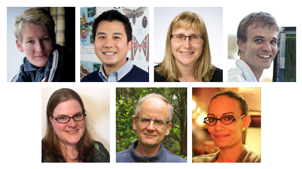
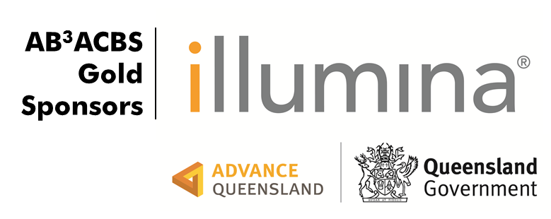
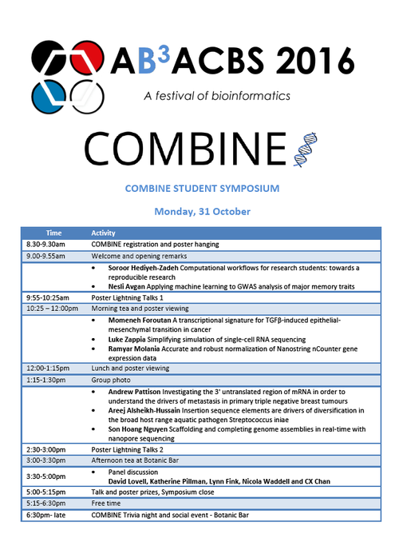
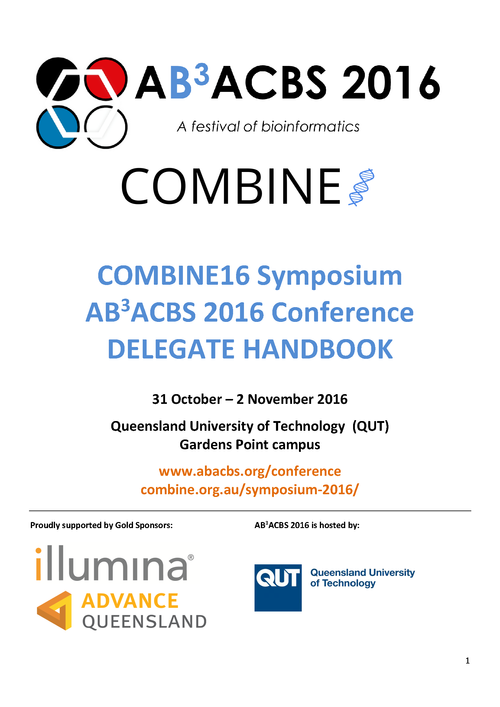
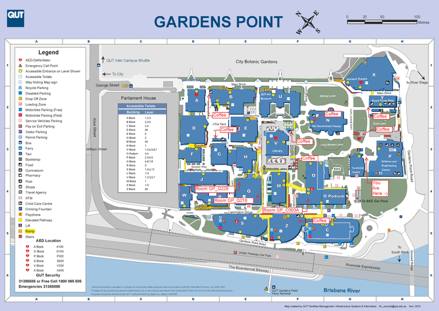
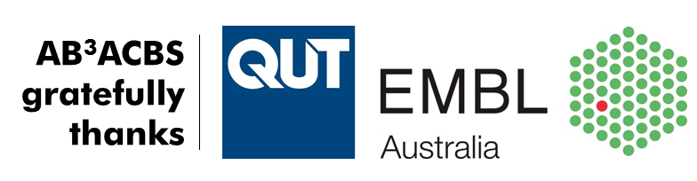

# ABACBS 2016
A festival of bioinformatics in Brisbane!

In 2016, the ABACBS national conference will run in conjunction with the B3 Symposium and be named "AB3ACBS-2016" (still pronounced "abacus")

- We are delighted to present to you an array of outstanding invited speakers:

- metabolomics specialist Ute Roessner from the University of Melbourne

- computational evolutionary biologist Simon Ho from the University of Sydney

- bioinformatician and plant evolutionary biologist Kate Hertweck from the University of Texas at Tyler

- expert in bioinformatics and cancer genomics, Andreas Schreiber, Centre for Cancer Biology, Adelaide

- microbial bioinformatics specialist Nouri Ben Zakour

- statistical bioinformatician and exponent of R/Bioconductor, Matt Ritchie from WEHI, Melbourne

with special guest Terri Attwood, renowned for her leadership of and contribution to major bioinformatics initiatives, including GOBLET, the Global Organisation of Bioinformatics Learning, Education and Training.

*Our speakers: (top row) Terri Attwood, Simon Ho, Ute Roessner, Matt Ritchie(bottom row) Kate Hertweck, Andreas Schreiber, Nouri Ben Zakour.Click here for bios and abstracts.*

This festival of events will run at the Queensland University of Technology from Oct 31 - Nov 9 2016 bringing together bioinformaticians and computational biologists, as a fusion of:

- the ABACBS Annual Conference

- B3, the Big Bioinformatics and Biology symposium, run at QUT annually

- COMBINE, the official student sub-committee of ABACBS

- GOBLET, the Global Organisation of Bioinformatics Learning, Education and Training.

- Bioconductor through the BioCAsia meeting and training workshop

### Schedule

<table border="1" style="width:100%" bordercolor="lightgrey">
  <tr>
    <th align="left">DATE</th>
    <th align="left">ACTIVITY</th>
    <th align="left">PLACE</th>
  </tr>
  <tr>
    <td>31 October <b>Monday</b></td>
    <td>
      <a href="https://combine.org.au/symposium-2016/">COMBINE Student Symposium</a> 
    	<i>and Trivia Evening from 6pm</i> 8am Registration, 9am Welcome</td>
    <td>QUT Gardens Point P514, Botanic Bar</td>
  </tr>
  <tr>
      <td>1 November <b>Tuesday</b></td>
      <td><a href="http://www.abacbs.org/conference/">AB3ACBS 2016 Conference</a> 
        <i>Day 1 and Conference Dinner </i><a href="https://www.google.com.au/maps/place/Mado+Turkish+Restaurant/@-27.4806764,153.0237853,15z/data=!4m5!3m4!1s0x0:0x5b4271e6f7118daf!8m2!3d-27.4806764!4d153.0237853">Mado's Turkish Restaurant</a> 8am Registration, 9am Welcome</td>
        <td>QUT Gardens Point P514</td>
  </tr>
  <tr>
      <td>2 November <b>Wednesday</b></td>
      <td>AB3ACBS 2016 Conference 
    	<i>Day 2 and ABACBS AGM</i> 9am start</td>
    <td>QUT Gardens Point P514</td>
  </tr>
    <tr>
      <td>3 November <b>Thursday</b></td>
      <td>Associated Workshops 
    	<i><a href="http://www.abacbs.org/gobletworkshops/">Best Practices in Bioinformatics Training</a></i> 
        <b>SOLD OUT</b> <i><a href="http://www.abacbs.org/biocasia2016workshop/">Intro to Bioconductor and Shiny</a></i></td>
      <td>QUT Gardens Point O303a Q228</td>
  </tr>
      <tr>
      <td>4 November <b>Friday</b></td>
      <td>Associated Workshops 
    	<b>SOLD OUT</b> <i><a href="http://www.abacbs.org/gobletworkshops/">Best Practices in Bioinformatics Training</a></i> 
        <i>Introduction to mixOmics <a href="https://aba-cbs.squarespace.com/s/mixOmics-workshop-4Nov.pdf">(download workshop details)</a></i> 
    	<i><a href="http://www.abacbs.org/biocasia2016/">Bioconductor Asia-Pacific Meeting</a></i></td>
       <td>QUT Gardens Point O303a Q218 Q228</td>

  </tr>
  <tr>
    <td>5-6 November <b>Saturday/Sunday</b></td>
      <td> 
    	<i></i></td>
       <td></td>
  </tr>
    <tr>
      <td>7-9 November <b>Monday - Wednesday</b></td>
      <td><a href="http://www.abacbs.org/goblet_agm/">GOBLET Annual General Meeting</a> 
    	<i></i></td>
      <td>QUT Gardens Point O303a</td>
  </tr>
    <tr>
      <td>10 November <b>Thursday</b></td>
      <td>Associated Workshops 
        <i><a href="http://www.abacbs.org/abacbsgobletrnaseqcourse/"> RNA-seq data analysis</a></i></td>
      <td>QUT Gardens Point O508</td>
  </tr>
</table>

### Conference Booklet and Delegate Handbook
Please click on the images below to download the booklet and handbook as PDF files.

[AB3ACBS Booklet V6](AB3ACBS_booklet_v6.pdf)
[AB3ACBS Delegate Booklet V12](AB3ACBS_2016_delegate_handbook_v12.pdf)

## Early-Career Researcher - Oral presentation prizes

Please vote for your favourite oral presentation from an early-career researcher at AB3ACBS by clicking on this link: https://goo.gl/forms/Vlv925TezZCv6oDK2 

### Information for Students

**STUDENT TALK/POSTER VOTING**

Student orals: https://goo.gl/forms/5z2ApwQO9pIK1Tms2

Student posters: https://goo.gl/forms/RKin4tYB97OEEFJ42

### Best combine presentation gets a slot at AB3Acbs

Congratulations to Ramyar Molania for winning first place at COMBINE16! Ramyar will be presenting his talk, "Accurate and robust normalization of Nanostring nCounter gene expression data" at AB3ACBS on Wednesday, 2nd November. 

### Student Travel Bursaries

AB3ACBS 2016 and the COMBINE Symposium aim to support student participation by awarding travel bursaries.

Students may apply using the abstract submission form

Our funds are limited: not all applicants will receive bursaries, nor may bursaries cover all costs

At this stage, we are unable to fund international travel

Bursaries will be allocated considering

Quality of abstract

Likely cost of travel

Attendance at both COMBINE and ABACBS events

### COMBINE16 REGISTRATION REIMBURSEMENT

We will be offering a number of registration refunds to full-time students attending the COMBINE16 Symposium based on the following criteria:

- Financial need (i.e. students without school/supervisor funding)

- Time of registration (students registering earlier will be preferred)

The reimbursement amount will be $40 and will be refunded after attendance of COMBINE16

Unfortunately, we are unable to offer refunds to all students. To apply for a registration reimbursement, please fill out this form after you have registered for COMBINE16.

## Location: QueeNsland University of Technology (QUT - Gardens Point Campus)

MAYBE ADD GOOGLE MAPS HERE

## Social Media

Share the energy and enlightenment of this Festival of Bioinformatics on Twitter using

the hashtags #COMBINE16 for the student symposium and #AB3ACBS for the conference

the handles @abacbs and @combine_au

