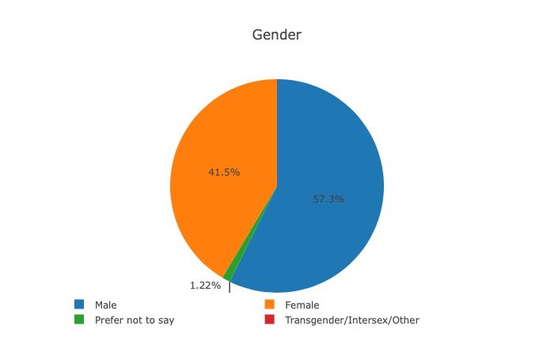
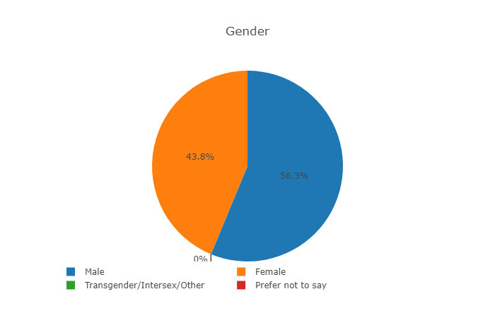
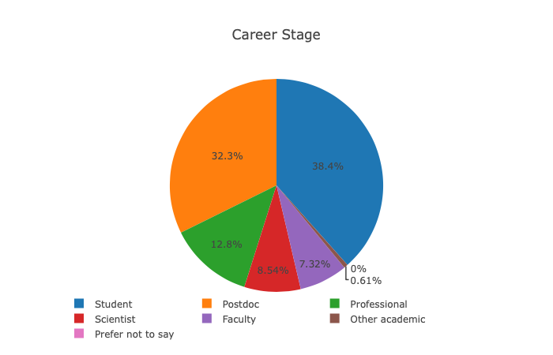
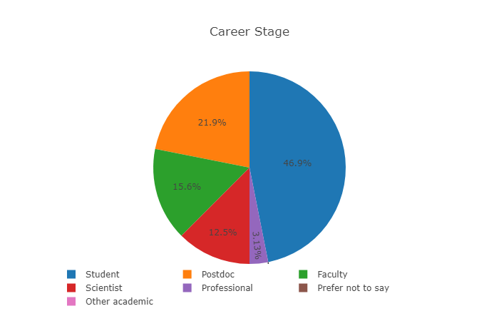
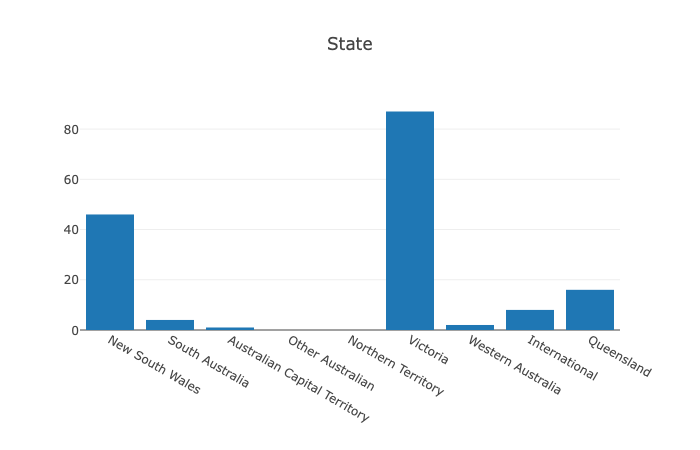
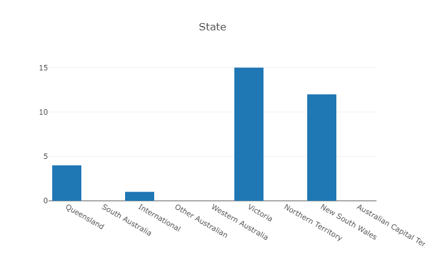
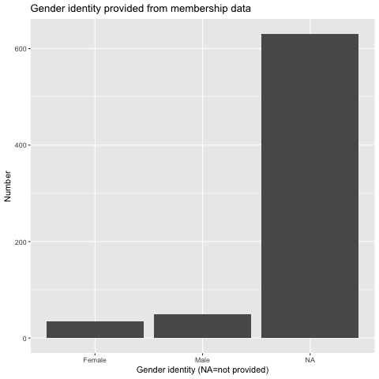
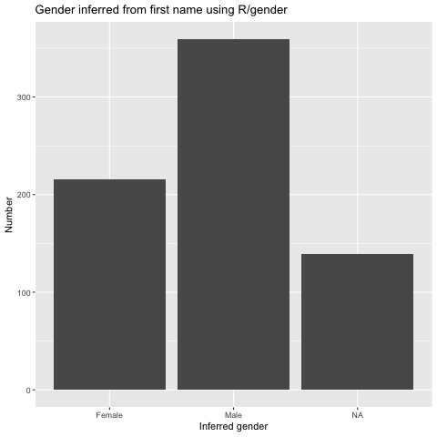
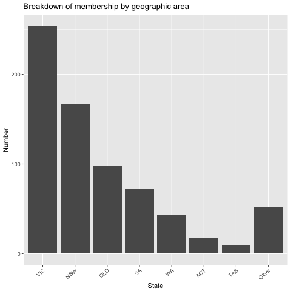
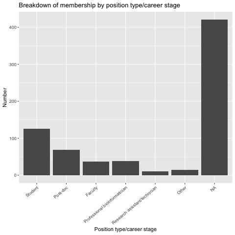

This Diversity Report provides details of gender balance and other forms of diversity at the ABACBS-2018 National Conference.

The ABACBS Diversity Policy can be found [here](https://www.abacbs.org/s/ABACBS-Gender-Equity-and-Diversity-Policy-dlcn.pdf). The current ABACBS Code of Conduct can be found [here](https://www.abacbs.org/codeofconduct). Note that this is currently being improved. The new Code of Conduct will be be uploaded when approved by the executive committee.

## Other Initiatives

The society has developed a new abstract submission system that will support blinded review of abstracts by the Program Committee. The submission system also provides a live update of the diversity of lead authors of submitted abstracts, including gender identification, geographic area and career stage.

## Status of Conference Diversity

### Committees

- Organising Committee — Co-convenors: 1 female & 1 male; Committee: 6 females & 6 males
- Workshop Committee: 2 females & 2 males
- Program Committee: 50% females and 50% males
- COMBINE Student Symposium Committee — Co-chairs: 1 female & 1 male; Committee: 5 females & 5 males

### Chairs, speakers, bursaries

- Conference session chairs: 4 female and 4 male
- Invited international keynote speakers: 2 females & 2 males
- Invited national keynote speakers: 2 females and 2 males (geographical diversity: 2 from Queensland, 1 from Melbourne, 1 from Sydney)
- Special invited speakers: 1 female (US) invited and 1 male (Melbourne) invited
- Talks selected from abstracts: aimed for approximate balance across different areas of diversity, including gender identity
- Travel bursaries: 50% females and 50% males

## Abstract diversity data

As at November 28 (conference end).

**Gender — submitted**

**Gender — selected**

**Career stage — submitted**

**Career stage — selected**

**Geography — submitted**

**Geography — selected**

## Society Membership Diversity

Based on membership data as at 20/7/2018. As we only started collecting information on gender in 2018, we have inferred gender from names to give a clearer picture of current gender distribution of members.

Distribution of gender identities. Categories are female, male, trans/intersex/other, and prefer not to say. NA=no data.

As we only started collecting information on gender in 2018, we have inferred gender from names to give a clearer picture of current gender distribution of members.

Number of members from each state or territory. Other includes New Zealand and other regions.

Number of members from each career stage/type. NA=No information provided.
