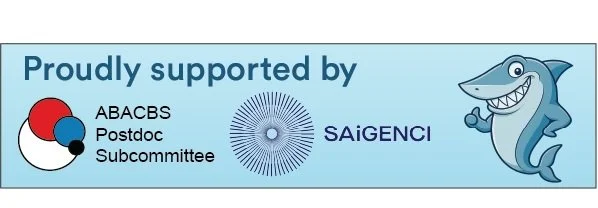

The ABACBS Post-doc Subcommittee is excited to present the **2025 ABACBS EMCR Shark Tank**, a full-day event on **Monday 24th November 2025**, from **10:00 AM to 5:00 PM**. Hosted as part of the 2025 ABACBS Conference, this fast-paced competition invites early- and mid-career researchers to form teams, develop bold research proposals, and pitch their ideas to a panel of “sharks”, leading experts from academia and industry.

But the EMCR Shark Tank is more than just a competition, it’s a unique opportunity to connect with fellow bioinformaticians from across Australia, sharpen your research proposal skills, and build your network. Whether you’re just getting started or already making waves, this event is designed to break silos and spark ideas across disciplines and institutions.

Thanks to the generous support from the Computational Oncology Program at SAiGENCI (South Australian immunoGENomics Cancer Institute), we are offering **three $500 travel scholarships for post-docs** to attend this year’s ABACBS Conference, as well as **eight free registrations** for the EMCR Shark Tank event. See details below for how to apply.

Step into the tank. It’s sink or swim, and the sharks are hungry!

To register, [please use the registration portal on the conference home page](https://iscb.swoogo.com/abacbs2025).

## Format & Judging

- Teams will be assigned on the day to encourage cross-institutional collaboration.
- In the morning, teams will develop their proposals with guidance from experienced academic mentors.
- In the afternoon, each team will present their proposal to the sharks in a rapid-fire pitch session.
- The sharks will decide which ideas get “funded” and crown the winning team **($50 gift card prize for each member)**.
- The most compelling sharks will also be judged… on how well they spend their budget!

## Travel scholarship and registration waiver application

All scholarship applicants will be assessed and ranked. The top three ranked applicants will each receive a $500 travel scholarship, while the next eight ranked applicants will receive a full refund of their early-bird Shark Tank registration fee.

**Steps and timelines for the event registration and scholarship application:**

1. **Register for Shark Tank event & ABACBS 2025.**
2. **Apply for the Shark Tank scholarship [using the application form](https://docs.google.com/forms/d/e/1FAIpQLScwPfeGk3OQk8VGk8fF2ZgTivWjyaTpa45GvfR8W8PShDo0fg/viewform).**

## Organising committee

- Emma de Jong (The University of Western Australia, WA)
- Feargal Ryan (Flinders University, SA)
- Hani Kim (Garvan Institute of Medical Research, NSW)
- Jie Liu (The University of Adelaide, SA)
- Jacqueline Rehn (SAHMRI, SA)
- Monika Mohenska (Monash University VIC, The University of Adelaide, SA)
- Melanie Smith (Flinders University, SA)
- Ning Liu (The University of Adelaide, SA)
- Nora Liu (Chair, The University of Adelaide, SA)
